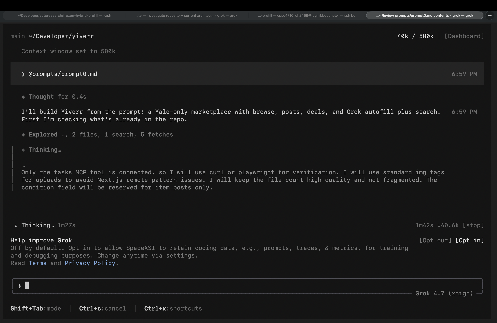

# Yiverr

**Video**

[Google Drive](https://drive.google.com/file/d/1sGXpNallxQmbdUXS5Lq_32gwL5e-VVkB/view?usp=share_link)

[yiverr-pitch.mov](photos/yiverr-pitch.mov)

**Grok usage**



A marketplace for Yale students. People post services, requests, and things from their rooms. Someone else books, buys, or says they can do it. When a deal is accepted, both sides see each other's Yale email and a Venmo link.

Seeded listings use photos from Unsplash. New uploads are saved in `public/uploads`.

## Run

```bash
npm install
cp .env.example .env.local
npm run seed
npm run dev
```

Open http://localhost:3000.

`.env.local` is gitignored. Put the key there, not in the client:

```bash
XAI_API_KEY=your_key
GROK_MODEL=grok-4.7
```

`GROK_MODEL` must accept images. `grok-4.7` does. Grok is only called from server routes. Restart `npm run dev` after you change the env file.

Without a key, search still returns local matches and says so. Autofill asks you to fill the form yourself.

Other commands:

```bash
npm run seed       # reset data/db.json
npm run smoke      # check seed counts, search, deals, and chat rules
npm run typecheck
npm run build
```

## Demo accounts

There is no password. Sign-in stores a user id in a cookie. A non-`@yale.edu` email is rejected. **Switch user** in the navbar lists the three seeded students:

| Name | College | Year | Email |
| --- | --- | --- | --- |
| Cheng-You Ho | Benjamin Franklin | 2030 | chengyou.ho@yale.edu |
| Carter Lagasse | Branford | 2027 | carter.lagasse@yale.edu |
| Carlos Cedano | Ezra Stiles | 2029 | carlos.cedano@yale.edu |

Cheng-You starts with 2 posts and 3 deals received. Carter and Carlos own the rest of the catalog, so switching user shows the other side of the same deals.

Deals already on the board:

- Carter and Carlos both offered on Cheng-You's posts. Cheng-You sees those under Deals received, with Accept and Decline.
- Cheng-You asked Carter for a fade and Carlos about a floor lamp. Those sit under Deals sent for Cheng-You, and under Deals received for Carter and Carlos.
- Carlos booked Carter's moving help and Carter already accepted it. Both of them see the email and **Pay with Venmo**. The note says to mark the payment as Goods & Services.

Each of those deals has a chat. The latest message is from the other person. Sending a new one works from the deal card or from Inbox. Switch user and the same thread is there, with your messages on the right.

`npm run seed` wipes posts, deals, and messages and writes that starting state again.

## What to click

1. Sign in as Cheng-You. Browse has Services, Requests, and Items, plus category chips and a price sort. Every card has a photo.
2. Open Dashboard. Confirm 2 posts and 3 deals received. Reply in one of the chats.
3. Switch to Carter. The fade request has Accept. The headshot offer does not. The accepted move shows Venmo.
4. Switch to Carlos. The floor-lamp thread is a deal he can accept. His fridge offer is one he sent.
5. Post an item with a photo, or a service from one sentence, and press Write with Grok. The status line says "Grok is writing your listing…". Edit the draft, then post it.
6. Search in plain language, for example `furnish my single for under $150`. A bundle card shows the items and a total. If nothing matches, the page links to a request with that sentence filled in.

## Stack

Next.js App Router, TypeScript, and Tailwind. All data lives in `data/db.json`, read and written only through `lib/db.ts`. No external database.

```
data/db.json                 users, posts, deals, messages
lib/seed-data.ts             3 students and the starting listings
lib/mutate.ts                posts, deals, and chat messages
lib/search.ts                local bundle and keyword matching
lib/grok.ts                  OpenAI SDK, base URL https://api.x.ai/v1
app/api/ai/autofill          listing draft from a photo or a sentence
app/api/ai/search            ranked results and an optional bundle
app/inbox                    chat for both sides of a deal
public/uploads               photos from the create form
```

Categories are fixed.

Services: Photography, Design & Creative, Hair & Beauty, Moving & Labor, Tech Help & Repair, Music & Performance, Errands & Delivery, Other Services.

Items: Furniture, Appliances, Electronics, Clothing, Decor, Books, Other Items.

Requests use either list. Each category has at least three listings.
